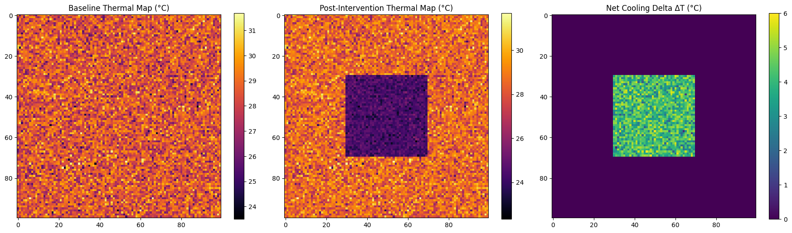

# 🌍 HyperScale-ThermalSim: Geospatial Thermal Downscaling Engine

`HyperScale-ThermalSim` is a physical and machine learning-driven geospatial framework engineered for meter-scale urban heat downscaling, cloud-optimized spatio-temporal processing, and counterfactual microclimate intervention simulation.

## 📊 Microclimate Intervention Simulation Output

## 🏗️ Technical Highlights & Architecture
- **Cloud-Optimized Array Storage:** Ingests multi-dimensional climate arrays using `xarray`, `Dask`, and chunked `Zarr` stores (`thermal_data.zarr`) for sub-second spatial queries.
- **Spatial Super-Resolution:** Trains an `XGBoost` regressor across 240,000 spatial samples using physical covariates (NDVI, Albedo, Urban Building Density).
- **Spatial Leakage Mitigation:** Evaluates performance using **5-Fold Block-Spatial Cross-Validation** to eliminate spatial data leakage across geographic folds.
- **Discrete Spatial Indexing:** Maps spatial latitude and longitude coordinates into **Uber H3 spatial geohash grid cells** (`resolution=9`).
- **Intervention Sandbox:** Performs counterfactual simulations (e.g., adding tree canopy and high-albedo cool roofs) to output thermal mitigation deltas ($\Delta T = 6.01^\circ\text{C}$ cooling).

> *Note on Data Pipeline:* This repository serves as a validated architectural benchmark. The demonstration runs on chunked synthetic rasters to evaluate spatio-temporal array I/O, H3 geohash partitioning, and block-spatial cross-validation mechanics prior to ingesting real Landsat 8/9 LST STAC rasters via `rioxarray`.

## 🛠️ Tech Stack
`Python` • `xarray` • `Zarr` • `Dask` • `XGBoost` • `h3-py` • `geopandas` • `scikit-learn` • `matplotlib`
